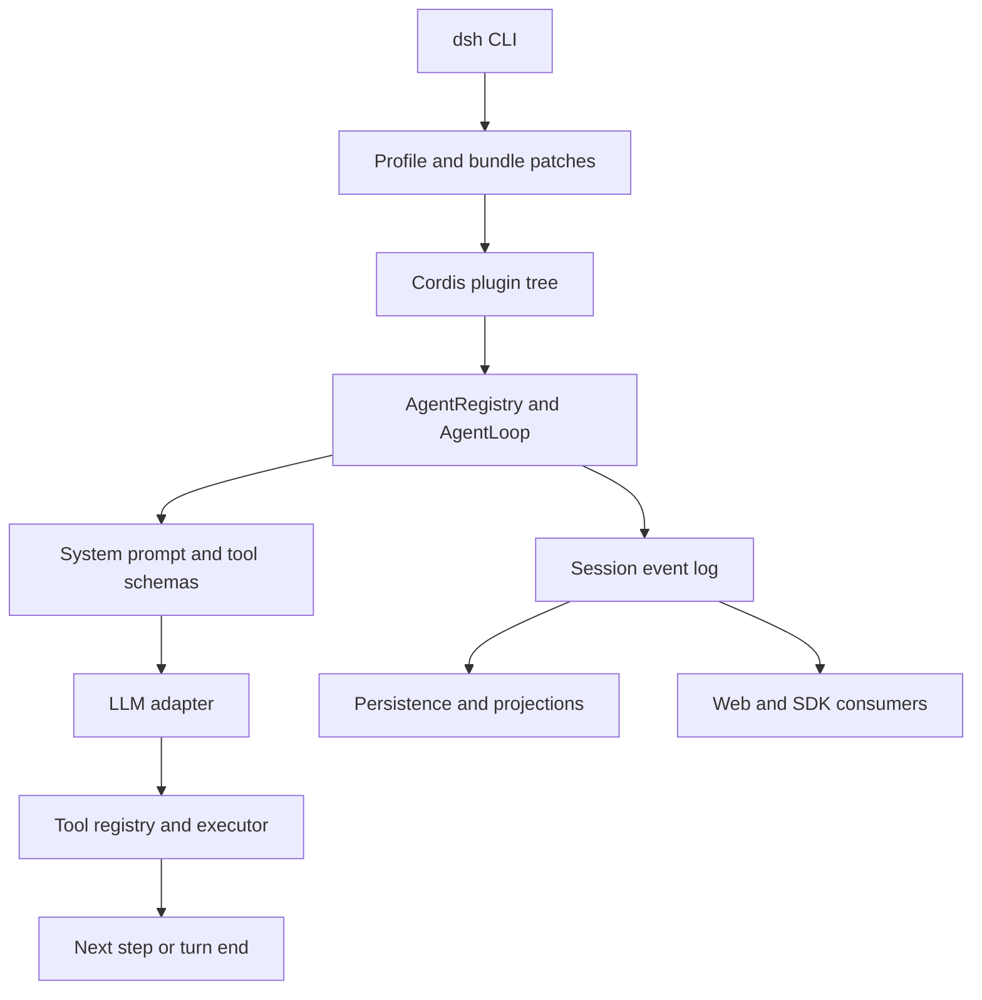

# DeepSeek Harness source learning checklist

English | [中文](source-learning-checklist.zh.md)

## Summary

This tutorial takes you from a first visit to the repository to explaining a complete conversation, reading tests, and writing your first tool plugin. Complete the checkboxes in order and keep diagrams, source locations, or test observations as evidence. The main path covers Cordis, application composition, the agent loop, tools, and Sessions before you choose Web, SDK, or another specialty. Initial reading needs no dependency installation, project build, or LLM API key; prepare runnable exercises separately with the [development guide](../development.md).

## Table of Contents

- [Study method and schedule](#study-method)
- [Build the overall picture](#big-picture)
- [Stage 0: Define your learning goals](#stage-0)
- [Stage 1: Prepare technical foundations and understand the environment](#stage-1)
- [Stage 2: Navigate the repository](#stage-2)
- [Stage 3: Understand Cordis plugins](#stage-3)
- [Stage 4: Trace startup, profiles, and configuration composition](#stage-4)
- [Stage 5: Separate the core services' responsibilities](#stage-5)
- [Stage 6: Trace a complete turn](#stage-6)
- [Stage 7: Explore tool registration and execution](#stage-7)
- [Stage 8: Understand model adapters, prompts, and context](#stage-8)
- [Stage 9: Understand Session logs, persistence, and projections](#stage-9)
- [Stage 10: Understand cancellation, errors, permissions, and cleanup](#stage-10)
- [Stage 11: Learn behavior through tests](#stage-11)
- [Stage 12: Design and implement your first tool plugin](#stage-12)
- [Elective routes](#electives)
- [Integrated exercises and final assessment](#assessment)
- [Reading record template](#reading-record)
- [Further Exploration](#further-exploration)
- [Dev Note](#dev-note)

-----

<a id="study-method"></a>
## Study method and schedule

Complete stages 0–12 before choosing an elective route. The times below are planning estimates for reading, diagrams, and notes; they do not predict build duration or guarantee proficiency. If you know TypeScript, Node.js, or plugin development, use each stage's assessment to decide whether to skip it.

| Week | Suggested content | Estimated effort | Weekly outcome |
|---|---|---|---|
| Week 1 | Stages 0–2 | 8–12 hours | Goals, prerequisite study list, repository map |
| Week 2 | Stages 3–4 | 10–14 hours | Plugin lifecycle diagram, startup and configuration diagram |
| Week 3 | Stages 5–6 | 10–14 hours | Core service diagram, conversation sequence diagram |
| Week 4 | Stages 7–8 | 10–14 hours | Tool call path, model request assembly notes |
| Week 5 | Stages 9–10 | 10–14 hours | Log and projection diagram, failure handling matrix |
| Week 6 | Stages 11–12 | 10–16 hours | Test reading record, first plugin and verification plan |
| Weeks 7–8 | One elective route and integrated assessment | 12–20 hours | Specialized call path, independent explanation or small contribution |

- [ ] Spend each 45–90 minute session on one concrete question, such as where user input becomes a model message.
- [ ] Investigate each question in this order: documentation overview, public types, implementation entry, one successful test, and one failure test.
- [ ] Record a function's inputs, outputs, effects, service dependencies, events, failures, and resource owner.
- [ ] Record unfamiliar branches with their source locations, then return after completing the current path.
- [ ] Check an item only when you can explain it yourself and cite source or test evidence.
- [ ] Distinguish reading, static tracing, and execution; reading code does not establish a successful run.

<a id="big-picture"></a>
## Build the overall picture

Start with the [project introduction](../../README.md), [architecture](../architecture.md), and [glossary](../glossary.md). DeepSeek Harness provides an agent harness: the model generates responses and tool calls, while the Harness composes capabilities, drives execution, and records the work. The diagram shows the main relationships to recognize while learning; stage 6 traces exact event ordering.



Keep three distinctions in mind: a `Session` stores conversation facts, an `Agent` controls live work, and `AgentLoop` provides the default driver implementation; a turn contains zero or more steps; a step contains one model request and the tool execution it causes. The [architecture](../architecture.md) and [glossary](../glossary.md) own these definitions.

<a id="stage-0"></a>
## Stage 0: Define your learning goals

Goal: identify what you want to explain and produce after studying. Allow 1–2 hours.

Reading: [project introduction](../../README.md), [contribution guide](../../CONTRIBUTING.md), and [architecture](../architecture.md).

- [ ] Explain the responsibilities of the Harness, model API, tools, and chat interface in your own words.
- [ ] Explain what “everything is a plugin” means for models, tools, Sessions, the loop, and the interface.
- [ ] Distinguish learning from source, running the product, developing plugins, and changing core implementations.
- [ ] Make explaining one complete conversation your first overall goal.
- [ ] Choose an initial focus: tool plugins, model adapters, Web, SDK, or multiple agents.
- [ ] Write three questions you want source reading to answer and revisit them weekly.

Exercise and assessment: write a 200–300-character project explanation that connects user input, the model, tools, the Session log, and the interface. Do not depend on class names you cannot yet explain.

<a id="stage-1"></a>
## Stage 1: Prepare technical foundations and understand the environment

Goal: read the TypeScript and asynchronous patterns used here and identify runtime requirements. Allow 4–6 hours; study missing foundations separately.

Reading: [development guide](../development.md), [the Cordis tutorial's TypeScript notes](../cordis-tutorial/index.md#typescript-notes), [root package.json](../../package.json), and [workspace configuration](../../pnpm-workspace.yaml).

- [ ] Check local Node.js, pnpm, and Git versions against the Node.js minimum and pinned pnpm version in root `package.json`.
- [ ] Understand ESM, `import type`, package imports, and local `.ts` imports.
- [ ] Read interfaces, generics, unions, discriminant fields, narrowing, and exhaustive `never` checks.
- [ ] Understand how `declare module` extends `Context`, events, and other extensible types.
- [ ] Understand `Promise`, `async/await`, asynchronous iterators, and `for await`.
- [ ] Connect `AbortController`, `AbortSignal`, and `try/finally` to resource cleanup.
- [ ] Distinguish static TypeScript types from runtime validation of JSON, configuration, network data, and persisted data.
- [ ] Recognize pnpm workspaces, `workspace:*`, package `exports`, dependencies, and peerDependencies.
- [ ] Read the Host and Client TypeScript project layout and distinguish source checks from build artifacts.
- [ ] Understand that native Windows and WSL need separate dependencies and toolchains; choose the environment for later exercises.

Use these PowerShell commands for read-only environment checks and navigation. They do not install dependencies or build the frontend or backend.

```powershell
node --version
pnpm --version
git --version
Get-Content -LiteralPath 'package.json' -TotalCount 18
```

Exercise and assessment: find and explain one discriminated union, one declaration merge, and one asynchronous iteration in the core packages. Record whether the local environment meets repository requirements.

<a id="stage-2"></a>
## Stage 2: Navigate the repository

Goal: locate the documentation, package, implementation, and tests for a question. Allow 3–4 hours.

Reading: [package group index](../../packages/README.md), [subsystem index](../subsystems/README.md), [development guide](../development.md), and [testing policy](../testing.md).

- [ ] Find `apps/cli`, `apps/web`, and `apps/desktop`; distinguish product assemblies from capability packages.
- [ ] Find `packages/core`, `packages/boot`, and `packages/bundle` and explain their concerns.
- [ ] Find group READMEs for `packages/llm`, `packages/fs`, `packages/shell`, and `packages/session`.
- [ ] Find `packages/api`, `packages/host`, `packages/client`, and `packages/sdk` to establish a rough server and client map.
- [ ] Identify the purposes of `python`, `native`, `scripts`, `snapshots`, `benchmarks`, and `website` without exploring all implementations.
- [ ] Choose a package and read its `README`, `package.json`, `src/index.ts`, and `tests` in that order.
- [ ] Trace a root `package.json` command to its script implementation instead of guessing whether its name implies compilation.
- [ ] Distinguish the reading purposes of architecture pages, subsystem references, package READMEs, cookbooks, and Agent Notes.

```powershell
rg --files packages/core apps/cli/src
rg -n 'followup|steer|inject|cancel|whenIdle' packages/core/agent-loop/src/agent.ts
```

Exercise and assessment: locate the packages and test directories for changing a model provider, registering a file reading tool, and resuming a Session. Explain how you found them.

<a id="stage-3"></a>
## Stage 3: Understand Cordis plugins

Goal: understand service availability, plugin activation, event cooperation, and cleanup on unload. Allow 5–7 hours.

Reading: [Cordis primer](../cordis-primer.md), [Cordis tutorial chapters 1–6](../cordis-tutorial/index.md), and [scope reference](../subsystems/scope.md). Source entries: [scope](../../packages/core/scope/src/index.ts) and [a filesystem tool plugin](../../packages/fs/tool-fs/src/index.ts).

- [ ] Recognize function plugins, plugin modules with `apply`, and `Service` subclasses.
- [ ] Find a plugin's `name`, `inject`, `Config`, and `apply` and explain their purposes.
- [ ] Explain service access through `ctx.<service>` and dependency declarations through `inject`.
- [ ] Explain why declaration merging adds types but does not replace runtime service registration.
- [ ] Distinguish `emit`, `parallel`, `serial`, `bail`, and waterfall dispatch semantics.
- [ ] Explain `next()` in a waterfall listener and distinguish delegation from intentional short-circuiting.
- [ ] Find a contribution installed through `ctx.effect()` or `ctx.on()` that can be undone.
- [ ] Identify who owns a disposer, when it runs, and why repeated mounting requires cleanup.
- [ ] Understand registration visibility and lifetime through `agent.ctx` without treating parentage as scope inheritance.
- [ ] Read the HMR tutorial and distinguish configuration reloads from module reloads.

Exercise and assessment: diagram dependency readiness, plugin mounting, tool or listener registration, unloading, and registration removal. Find an existing test assertion about state after unload. Use the tutorial's temporary directory and launcher for hands-on examples.

<a id="stage-4"></a>
## Stage 4: Trace startup, profiles, and configuration composition

Goal: understand how invoking `dsh` produces a working plugin tree. Allow 4–6 hours.

Reading: [profiles and bundles in the architecture](../architecture.md), [boot subsystem](../subsystems/boot.md), and [app-boot README](../../packages/boot/app-boot/README.md).

Suggested source order: [bin.ts](../../apps/cli/src/bin.ts) → [args.ts](../../apps/cli/src/args.ts) → [profile-boot.ts](../../apps/cli/src/profile-boot.ts) → [app-boot](../../packages/boot/app-boot/src/index.ts) → [base configuration](../../packages/bundle/base/cordis.patch.yml) → [headless configuration](../../packages/bundle/headless/cordis.patch.yml).

- [ ] Distinguish profile launch, plugin management, and configuration export in `runCli()`.
- [ ] Find how parsed arguments reach `runProfile()`.
- [ ] Distinguish a profile, a bundle, a plugin, and a patch file.
- [ ] Identify the ordered configuration layers that compose a plugin tree from an empty entry list.
- [ ] Find the precedence of bundle, profile, custom home patch, and command-line patch layers.
- [ ] Verify that a patch replaces a target row's complete `config` instead of assuming recursive field merging.
- [ ] Locate the packages for the `session`, `tools`, `agent`, and `llm` rows in `base`.
- [ ] Compare `headless`, `web`, and `sdk` assemblies, then explain the standalone composition of `sdk-minimal`.
- [ ] Locate service readiness, startup failure reporting, and process shutdown handling.
- [ ] Confirm that supported Node applications launch through `dsh` profiles and reuse documented entry paths for exercises.

Exercise and assessment: diagram the path from the CLI entry to the `headless` runner. Choose one configuration field and explain its declaration, overrides, and final consumer. This stage can be completed through static reading.

<a id="stage-5"></a>
## Stage 5: Separate the core services' responsibilities

Goal: understand the core collaboration behind the default agent. Allow 3–4 hours. Read types and public methods before driver internals.

| Subject | Reading entry | Question to answer |
|---|---|---|
| Agent and registry | [agent/src/index.ts](../../packages/core/agent/src/index.ts), [types.ts](../../packages/core/agent/src/types.ts) | Who creates, finds, and controls live agents? |
| Default driver | [agent-loop/src/index.ts](../../packages/core/agent-loop/src/index.ts), [agent.ts](../../packages/core/agent-loop/src/agent.ts) | Who implements creation, resume, and turn progression? |
| Session and events | [session/src/index.ts](../../packages/core/session/src/index.ts), [types.ts](../../packages/core/session/src/types.ts) | Who stores facts and derives model history? |
| Prompt assembly | [system-prompt/src/index.ts](../../packages/core/system-prompt/src/index.ts) | How do prompt sections and tool declarations enter requests? |
| Tool registry | [tools/src/index.ts](../../packages/core/tools/src/index.ts) | How are tools discovered, restricted, and delegated to an executor? |
| Model service | [llm/src/index.ts](../../packages/llm/llm/src/index.ts) | How is a request bound to a provider adapter? |
| Scope | [scope/src/index.ts](../../packages/core/scope/src/index.ts) | How is a registration limited to one agent? |

- [ ] Write one responsibility statement for each of the seven subjects.
- [ ] Distinguish the `Agent` interface, `AgentRegistry`, `AgentLoop`, and `ReactLoopAgent`.
- [ ] Find the handles returned by `create()` and `resume()` and explain the creator's cleanup responsibility.
- [ ] Explain why `ctx.agents` and `ctx.sessions` are different kinds of storage.
- [ ] Explain how a log can exist without a corresponding live agent running.
- [ ] Identify which objects provide capabilities, apply policy, or own durable facts.
- [ ] Diagram the seven objects' dependencies using public services and events without expanding internal helpers.

Exercise and assessment: explain why adding a tool usually does not require changing the agent loop. Identify where that tool enters prompt assembly and execution.

<a id="stage-6"></a>
## Stage 6: Trace a complete turn

Goal: connect user input, model requests, tool execution, and logs in a verifiable sequence. Allow 7–10 hours; this is the main path's central stage.

Reading: [turn flow](../architecture.md), [lifecycle sequence](../agent-lifecycle.md), and [agent-loop README](../../packages/core/agent-loop/README.md). Source entries: [agent.ts](../../packages/core/agent-loop/src/agent.ts), [inbox.ts](../../packages/core/agent-loop/src/inbox.ts), and [headless runner](../../packages/bundle/headless/src/index.ts).

- [ ] Find how `followup()`, `steer()`, and `inject()` select input queues and whether to wake work.
- [ ] Explain what it means that `inject()` does not itself wake an agent.
- [ ] Follow `wakeDriver()`, `kick()`, and `turn()` through the default driver path.
- [ ] Distinguish a Session, a turn, and a step, including a turn with zero steps.
- [ ] Trace when input is claimed and how `preStep()` assembles prompts and dispatches `agent/pre-step`.
- [ ] Find how model selection is captured before a step and used during retries.
- [ ] Trace `prepareRequest()` and `prepareCall()` to locate prompt and user message commit timing.
- [ ] Connect `buildRequest()` to `session.deriveMessages()`.
- [ ] Trace how a model stream becomes `assistant/message` or `assistant/attempt`.
- [ ] Connect `tool/call`, batch execution, and `tool/result`.
- [ ] Explain why tool results can trigger another model request instead of immediately ending the turn.
- [ ] Find the purposes of `agent/turn-stopping`, `step/end`, `turn/end`, and `whenIdle()`.
- [ ] Mark durable Session events separately from live `agent/*` events.
- [ ] Confirm the deprecated status of `agent/request` in the README and consult current recommendations for new extensions.

Exercise and assessment: diagram a user requesting a file read, the model calling the read tool, and the model answering. Label every node with a source function or event name. Add branches for a direct answer without tools and rejection of the first input.

<a id="stage-7"></a>
## Stage 7: Explore tool registration and execution

Goal: understand the path from a tool declaration through model advertisement to actual effects on external state. Allow 5–7 hours.

Reading: [tools subsystem](../subsystems/tools.md), [tool pipeline](../tool-execution-pipeline.md), and [adding a tool](../cookbook/adding-a-tool.md). Source entries: [tools registry](../../packages/core/tools/src/index.ts), [contracts.ts](../../packages/core/tools/src/contracts.ts), [pipeline.ts](../../packages/core/tools/src/pipeline.ts), and [native executor](../../packages/core/tool-executor-native/src/index.ts).

- [ ] Find uses of `defineTool()` and declarations for names, descriptions, parameters, and results.
- [ ] Trace the cleanup capability returned by `ctx.tools.register()` and its lifetime owner.
- [ ] Distinguish tool definitions, tool visibility, step admission, and execution checks.
- [ ] Trace argument JSON validation and failure handling for missing tools or invalid arguments.
- [ ] Find the responsibilities of `tools/pre-execute`, `tools/execute`, and `tools/post-execute`.
- [ ] Distinguish the registry, executor, and tool implementation instead of assigning all batch scheduling to the tool function.
- [ ] Read how concurrency limits, cancellation signals, and tool results are passed.
- [ ] Compare [tool-fs](../../packages/fs/tool-fs/README.md), [fs](../../packages/fs/fs/README.md), and [fs-local](../../packages/fs/fs-local/README.md) to explain tool and filesystem provider responsibilities.
- [ ] Compare [tool-bash](../../packages/shell/tool-bash/README.md), [shell](../../packages/shell/shell/README.md), and [bash-local](../../packages/shell/bash-local/README.md) to identify Service Definition, Service Provider, and Consumer roles.
- [ ] Read one tool result's model text and UI presentation definition and identify their respective audiences.
- [ ] Find tests for at least three of success, validation failure, execution denial, and cancellation.
- [ ] Optionally compare the [PTC executor](../../packages/core/tool-executor-ptc/README.md) with native tool calls and record how execution is organized differently.

Exercise and assessment: trace one `read` invocation through registration, schema, executor, filesystem service, result, and log. Identify the appropriate layer for an access policy.

<a id="stage-8"></a>
## Stage 8: Understand model adapters, prompts, and context

Goal: identify where model input comes from and how model calls are separated from provider implementations. Allow 5–7 hours.

Reading: [LLM streaming](../subsystems/llm-streaming.md), [system prompt](../subsystems/system-prompt.md), [compaction](../subsystems/compaction.md), and [adding an adapter](../cookbook/adding-an-llm-adapter.md). Source entries: [LLM service](../../packages/llm/llm/src/index.ts), [DeepSeek adapter](../../packages/llm/llm-deepseek/src/adapter.ts), and [prompt assembly](../../packages/core/system-prompt/src/index.ts).

- [ ] Distinguish provider, model, adapter, credential source, and request controls.
- [ ] Read the [DeepSeek transport](../../packages/llm/llm-deepseek/README.md) and [API key provider](../../packages/llm/llm-deepseek-api-key/README.md) to separate shared transport from route registration.
- [ ] Find how `prepareCall()` captures the adapter and capabilities for a call.
- [ ] Trace text, reasoning, tool calls, and end information through the streaming abstraction.
- [ ] Explain the division between the model generating a Function Calling request and the Harness executing the tool.
- [ ] Locate assembly of prompt sections, tool schemas, and runtime context.
- [ ] Read [agent-instructions](../../packages/context/agent-instructions/README.md) and trace how workspace instructions enter model context.
- [ ] Explain why model-visible content must be reconstructable from the Session log and identify an implementation path.
- [ ] Read [llm-retry](../../packages/llm/llm-retry/README.md) to distinguish request failure, retry, and final commitment.
- [ ] Identify the packages responsible for token measurement, history compaction, attachments, and oversized tool output without exploring every algorithm.

Exercise and assessment: list the sources of system, user, assistant, and tool content in a request. Explain why the model streaming entry should not arbitrarily rewrite history already determined by the log.

<a id="stage-9"></a>
## Stage 9: Understand Session logs, persistence, and projections

Goal: distinguish chat presentation, model history, stored records, and derived state. Allow 6–9 hours.

Reading: [Session subsystem](../subsystems/session.md), [persistence](../subsystems/persistence.md), [Session projections](../subsystems/session-projection.md), and [format status](../session-format-status.md). Source entries: [Session](../../packages/core/session/src/index.ts), [message projection](../../packages/core/session/src/surface.ts), [persistence service](../../packages/session/session-persistence/src/index.ts), [JSONL provider](../../packages/session/session-persistence-jsonl/src/index.ts), and [projection service](../../packages/session/session-projection/src/index.ts).

- [ ] Read `SessionEventMap` and find message, turn, step, and tool event declarations.
- [ ] Trace `Session.append()`, event sequence numbers, read-only access, and `session/event` dispatch.
- [ ] Trace `deriveMessages()` and explain why the event log is not the array sent directly to the model.
- [ ] Distinguish `assistant/message`, `assistant/attempt`, and process-local live stream events.
- [ ] Separate the in-memory Session from persistence providers and explain the limitation of an in-memory service alone.
- [ ] Find persistence `create/open/stat/list/export` operations and explain their reading scope and purposes.
- [ ] Read generation selection, recovery, and publication rules in the JSONL README instead of rewriting historical files yourself.
- [ ] Compare creation, resume, and fork by input, identity, inherited history, and live state.
- [ ] Connect compaction's changes to the active message view with retention of original historical events.
- [ ] Read a projection definition and find initial state, event folding, snapshots, and lifetime ownership.
- [ ] Distinguish durable domain state, reconstructable projections, and process-local running state.
- [ ] Read [persistence type change review](../cookbook/reviewing-persistence-type-changes.md) to identify consumers to check before adding a durable field.

Exercise and assessment: annotate an existing Session fixture without changing it. Explain which events enter model history and which support recovery or presentation. Diagram the event log's relationship to model messages, projections, and UI.

<a id="stage-10"></a>
## Stage 10: Understand cancellation, errors, permissions, and cleanup

Goal: identify who stops work, records outcomes, and releases resources after a failure. Allow 4–6 hours.

Reading: [safety](../../SAFETY.md), [defensive patterns](../defensive-patterns/README.md), [approval](../subsystems/approval.md), [sandbox](../subsystems/sandbox.md), and [subprocesses](../subsystems/subprocess.md). Source entries: [cancellation](../../packages/core/agent-loop/src/agent.ts), [factory and cleanup](../../packages/core/agent-loop/src/index.ts), and [process shutdown](../../apps/cli/src/process-shutdown.ts).

- [ ] Trace how `cancel()` affects queued input, the model stream, and tool execution.
- [ ] Find distinct reporting paths for cancellation, business denial, configuration errors, network failures, and internal exceptions.
- [ ] Locate `HarnessError` and one concrete error to distinguish stable error codes from display text.
- [ ] Read recovery semantics for tools that did not start, unknown outcomes, and execution failures; do not assume an unknown result means success or safe retry.
- [ ] Distinguish user approval, file access policy, process sandboxing, and working directories.
- [ ] Find an owned resource and its cleanup path, such as a listener, handle, subprocess, or file.
- [ ] Check whether unload stops and awaits consumers before releasing their dependencies.
- [ ] Read initialization rollback and explain cleanup after partially successful creation.
- [ ] Find a cancellation or concurrent ordering test and explain the deterministic condition it awaits.

Exercise and assessment: make one row each for cancellation during request preparation, streaming, tool execution, and plugin unload. Record the cancellation target, log outcome, user feedback, cleanup owner, and test evidence.

<a id="stage-11"></a>
## Stage 11: Learn behavior through tests

Goal: use tests as verifiable behavior examples and select checks relevant to a change. Allow 4–6 hours.

Reading: [testing policy](../testing.md), [snapshot rules](../../snapshots/AGENTS.md), [check selection workflow](../../.agents/skills/dsh-pre-push-checks/SKILL.md), and [script declarations](../../package.json). Start with [agent-loop tests](../../packages/core/agent-loop/tests), [tools tests](../../packages/core/tools/tests), and [JSONL tests](../../packages/session/session-persistence-jsonl/tests).

- [ ] Read the setup, action, assertions, and cleanup of one Vitest case.
- [ ] Distinguish unit tests, real-API e2e, owner-local expected output, recorded Session replay, and browser verification.
- [ ] Explain what keyless replay and real-model verification can each establish.
- [ ] Find a main-path scenario in `snapshots` and read its input, composition, and expected events.
- [ ] Distinguish replay, record, and refresh and explain why fixture updates require review.
- [ ] Find a failure, edge, or cancellation test corresponding to one successful path.
- [ ] Check that tests verify files, logs, or service state instead of trusting an agent's textual answer alone.
- [ ] Identify requirements for API keys, build artifacts, native dependencies, browsers, and operating systems.
- [ ] Trace root scripts to identify compilation hidden behind test, lint, or typecheck command names.
- [ ] Choose the smallest relevant checks for a hypothetical small change and explain why a full repository suite is not the default.

Exercise and assessment: explain one existing test in a page of notes: its covered behavior, what it cannot establish, where to investigate failures, and whether it needs a build. Select actual execution according to the task; this checklist does not make a complete build a prerequisite for reading.

<a id="stage-12"></a>
## Stage 12: Design and implement your first tool plugin

Goal: connect the preceding concepts with a small, deterministic tool. Allow 6–10 hours. Finish the design before implementing it in an explicitly selected exercise directory.

Reading: [first Harness plugin](../user/develop/basic/index.md), [Cordis tutorial chapter 7](../cordis-tutorial/07-into-the-harness.md), [adding a tool](../cookbook/adding-a-tool.md), and [adding a package](../cookbook/adding-a-package.md).

Suggested exercise: design a `text_stats` tool that receives text and returns character and line counts. First decide whether characters mean Unicode code points, how empty text behaves, and whether a trailing newline produces an empty line. These are choices for your exercise, not a tool already supplied by the repository.

- [ ] Define the intended user, input, structured output, model-visible result, and failure cases.
- [ ] Define an accurate parameter schema, allowed empty values, input length, and counting rules.
- [ ] Choose a function or module plugin following the tutorial and declare the services actually needed.
- [ ] Use the tool registration API and tie registration to the plugin's unload lifetime.
- [ ] Separate pure text computation from Cordis registration so each part has a clear responsibility.
- [ ] Describe when to use the tool and what it returns without requiring the model to guess a format.
- [ ] Design meaningful cases for ordinary text, Chinese text, empty text, newlines, and invalid arguments.
- [ ] Verify that the tool disappears after unload and remounting leaves no old registration.
- [ ] Integrate through the tutorial's real profile and patch path, distinguishing a direct function call from complete tool pipeline verification.
- [ ] Design a repository-compliant recorded Session scenario for model-visible behavior and run it when the environment is ready.
- [ ] Document configuration, use, limitations, and verification; add required package documentation if creating a formal package.
- [ ] Once builds are permitted and the environment is ready, verify that the model receives the tool declaration, results enter the log, and the final answer uses them.

Exercise and assessment: deliver the plugin design, implementation, tests, and observation record. Label evidence as design only, static check, or executed verification. Explain discovery, execution, logging, and unload.

-----

<a id="electives"></a>
## Elective routes

Choose one specialty after the main path. Allow 6–10 hours per route and finish one before expanding sideways.

### A: Web and client

Reading: [Web Client](../subsystems/web-client.md), [Web Server](../subsystems/web-server.md), [Conversation](../subsystems/conversation.md), and [remote API](../cookbook/adding-a-remote-api.md). Source entries: [apps/web](../../apps/web), [Host](../../packages/host), [API](../../packages/api), and [Client](../../packages/client).

- [ ] Follow client startup and plugin activation from `apps/web/src/main.ts`.
- [ ] Trace a message submission through the client, remote API, controller, and agent.
- [ ] Trace a Session event into client state and a Conversation node.
- [ ] Distinguish raw Session events, projections, transcripts, and concrete React rendering.
- [ ] Read the responsibilities of slots, store, connection, and locale, then trace one UI feature to its owner.
- [ ] Read client subtree instructions and the UI design workflow for component structure, localization, responsiveness, and rendered verification.

Assessment: diagram the send button, server handling, Session events, and page updates. Identify one real file at every layer.

### B: TypeScript and Python SDKs

Reading: [SDK group](../../packages/sdk/README.md), [TypeScript client](../../packages/sdk/client/README.md), [SDK server](../../packages/sdk/server/README.md), and [Python SDK](../../python/sdk/README.md).

- [ ] Distinguish the SDK protocol, client wrapper, server plugin, and `dsh` runtime.
- [ ] Compare `packages/sdk/client`, `server`, and `protocol` to locate a request and an event subscription.
- [ ] Compare `python/sdk/src/deepseek_harness/client.py` to identify capabilities shared by both languages.
- [ ] Trace profile and patch selection and startup of the supported runtime.
- [ ] Read an example and test for Session creation, input submission, cancellation, or resource cleanup.
- [ ] Explain why loop and Session event changes require checking expected output in both SDKs.

Assessment: explain how an external program drives a Session, receives events, and closes resources. Identify the cross-process communication.

### C: Subagents, goals, and workflows

Reading: [Subagent](../subsystems/subagent.md), [Agent team](../subsystems/agent-team.md), [Goal](../subsystems/goal.md), [Workflow](../subsystems/workflow.md), and [Jobs](../subsystems/jobs.md). Source entries: [subagent](../../packages/subagent), [team](../../packages/team), [goal](../../packages/goal), [workflow](../../packages/workflow), and [jobs](../../packages/jobs).

- [ ] Distinguish subagents, shared teams, background jobs, same-Session goals, and workflows.
- [ ] Trace the owner, child Session, parentage, completion notification, and cleanup of a child agent.
- [ ] Identify the mechanisms that determine child scope visibility and inherited history.
- [ ] Trace a cross-agent message into the inbox and model context.
- [ ] Distinguish Goal Rounds, turns, and steps without treating policy loops as core loop definitions.
- [ ] Read tests for cancellation, parent shutdown, or child failure and record notification and cleanup order.

Assessment: diagram a main agent delegating work and receiving a result, then add child failure and parent cancellation branches.

### D: System capabilities, MCP, and tool integration

Reading: [filesystem](../subsystems/filesystem.md), [Shell](../subsystems/shell.md), [Terminal](../subsystems/terminal.md), [MCP](../subsystems/mcp.md), and [Skills](../subsystems/skills.md). Source entries: [fs](../../packages/fs), [shell](../../packages/shell), [subprocess](../../packages/subprocess), [terminal](../../packages/terminal), [mcp](../../packages/mcp), and [skill](../../packages/skill).

- [ ] Choose one capability and locate its Service Definition, Service Provider, and Consumer.
- [ ] Distinguish a one-shot shell command, persistent terminal, underlying subprocess, and background job.
- [ ] Trace how path resolution, working directories, sandboxing, and approval affect a tool invocation.
- [ ] Read the adaptation of external MCP tool discovery and calls and mark external data validation.
- [ ] Read skill discovery, loading, and context presentation and distinguish instructions from executable tools.
- [ ] Record resource ownership for one system capability during success, denial, cancellation, timeout, and unload.

Assessment: explain which consumers can be reused when replacing a capability's provider and which configuration and tests must change.

### E: Desktop, builds, and performance

Reading: [Desktop](../../apps/desktop/README.md), [development guide](../development.md), [benchmark guide](../../BENCHMARK.md), and [performance workflow](../../.agents/skills/dsh-speed-up-perf/SKILL.md). Source entries: [apps/desktop](../../apps/desktop), [native](../../native), [benchmarks](../../benchmarks), and [build.ts](../../scripts/build.ts).

- [ ] Trace the responsibilities of Electron, Desktop Host, the Web application, and the shared CLI.
- [ ] Distinguish source, type declarations, runtime bundles, Web assets, and native artifacts.
- [ ] Read Host and Client compiler configurations and build dependencies instead of substituting a full build for reading.
- [ ] Locate documentation for packaging, signing, and platform differences and select later experiments for your operating system.
- [ ] Choose a benchmark and explain its input scale, metrics, budgets, and execution requirements.
- [ ] Define reproducing input and measurement before proposing a performance optimization.

Assessment: explain the artifacts that compose a released application, or choose a long-Session performance problem and propose repeatable measurements.

-----

<a id="assessment"></a>
## Integrated exercises and final assessment

Organize the results into four small deliverables. Keep source and test evidence during static analysis; separately record the environment, operations, and observations for execution. Exercise operations affect only the files and data you select.

| Exercise | Task | Assessment evidence |
|---|---|---|
| Startup tracing | Explain a profile's composition from the `dsh` entry | Startup diagram, configuration order, key source links |
| Conversation tracing | Explain input, the model, one tool call, and the final answer | Sequence diagram, Session events, corresponding tests |
| Plugin development | Complete `text_stats` or a tool of similar scope | Input and output rules, implementation, lifecycle, verification record |
| Failure analysis | Choose cancellation, invalid arguments, or provider failure | Trigger, logs, feedback, cleanup, and recovery explanation |

Answer these questions without notes. Return to the relevant stage for any uncertain item.

- [ ] Why can the agent loop itself be a plugin?
- [ ] What problems do profiles, bundles, plugins, and patches each solve?
- [ ] How do `inject`, `ctx` services, and TypeScript declaration merging work together?
- [ ] When must a waterfall listener delegate through `next()`, and when does it intentionally short-circuit?
- [ ] How do an `Agent`, a `Session`, a turn, and a step differ?
- [ ] How do `followup`, `steer`, and `inject` differ in queuing and waking work?
- [ ] How does a tool enter a model request and then the real execution path?
- [ ] Why must a model request be reconstructable from the log?
- [ ] Why are Session logs, model messages, projections, and UI presentation separate?
- [ ] How do resume, fork, and creation differ?
- [ ] During cancellation and unload, who stops work, waits for it, and releases dependencies?
- [ ] For a small requirement, can you find the extension point, implementation, documentation, and smallest relevant verification?

Once you can explain the main path independently, use tests to explain failure behavior, and complete a small plugin, consider replacing a persistence backend, defining complex workflows, or changing the default loop.

<a id="reading-record"></a>
## Reading record template

Copy this template into your notes for each reading session. Record questions and evidence; prefer READMEs, source, and tests when reading current public behavior.

```markdown
# 本次阅读：主题

- 日期：
- 要回答的问题：
- 前置概念：
- 文档与源码入口：
- 关键类型与函数：
- 输入与输出：
- 服务依赖与事件：
- 持久状态与进程内状态：
- 失败、取消与资源释放：
- 正常路径测试：
- 失败或边界测试：
- 我的解释或图：
- 验证级别：已阅读 / 已静态追踪 / 已运行
- 运行环境、操作与观察（如有）：
- 尚未解决的问题：
- 下一次阅读：
```

<a id="further-exploration"></a>
## Further Exploration

These documents own architecture, concepts, implementation references, and extension guidance respectively. Open them when you need more depth.

- [Architecture](../architecture.md): verify plugin composition, the default loop, and extension locations.
- [Cordis tutorial](../cordis-tutorial/index.md): practice plugins, services, events, and lifecycle step by step.
- [Subsystem index](../subsystems/README.md): look up domain types and behavior semantics.
- [Extension cookbook](../cookbook/extension-cookbook.md): select an extension approach for a concrete need.
- [Testing policy](../testing.md): match verification evidence to behavior.
- [Defensive patterns](../defensive-patterns/README.md): understand design requirements that prevent common repository defects.

<a id="dev-note"></a>
## Dev Note

<details>
<summary>Non-authoritative notes</summary>

None.

</details>
