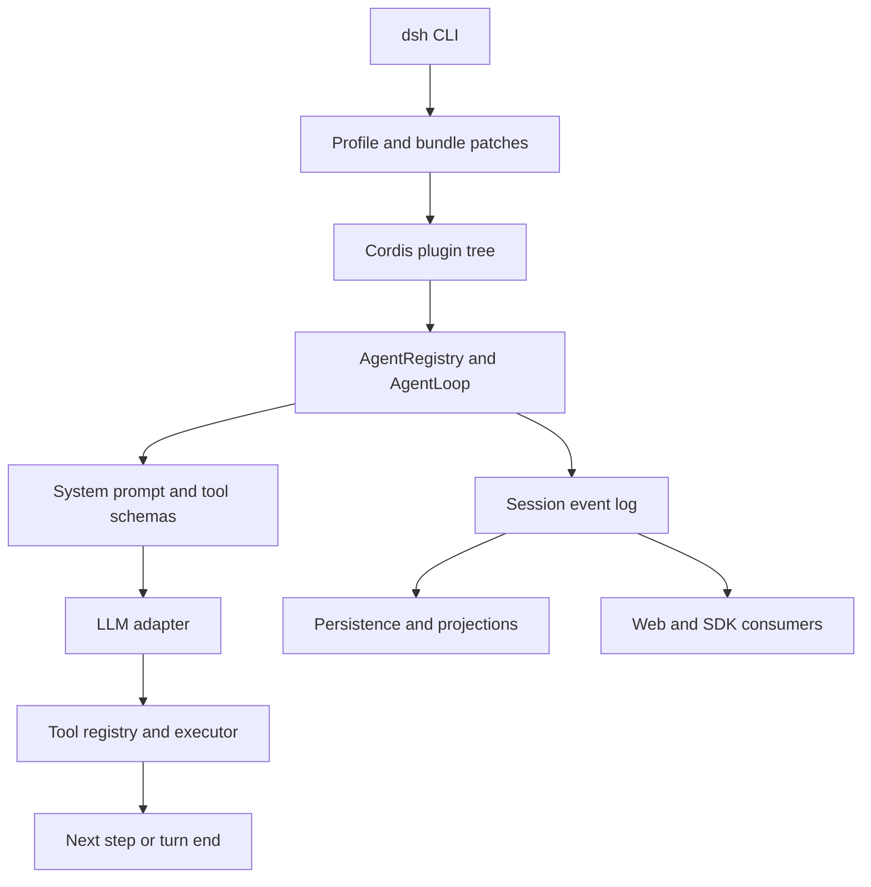

# DeepSeek Harness 源码学习清单

[English](source-learning-checklist.md) | 中文

## 概述

这是一份从初次接触仓库到能够解释一次完整对话、阅读测试并编写第一个工具插件的学习教程。按阶段完成复选框，并保留图、源码位置或测试观察作为学习成果。主线先学习 Cordis、启动组合、agent loop（智能体循环）、工具和 Session，再按兴趣选择 Web、SDK 等方向。前期只读源码，不要求先安装依赖、构建项目或申请 LLM（大语言模型）API 密钥；运行练习另按[开发指南](../development.zh.md)准备。

## 目录

- [学习方式与进度安排](#study-method)
- [先建立整体认识](#big-picture)
- [阶段 0：明确学习目标](#stage-0)
- [阶段 1：补齐技术基础与环境认知](#stage-1)
- [阶段 2：学会在仓库中定位代码](#stage-2)
- [阶段 3：理解 Cordis 插件体系](#stage-3)
- [阶段 4：追踪启动、profile 与配置组合](#stage-4)
- [阶段 5：区分核心服务的职责](#stage-5)
- [阶段 6：完整追踪一个轮次](#stage-6)
- [阶段 7：深入工具注册与执行](#stage-7)
- [阶段 8：理解模型适配、提示词与上下文](#stage-8)
- [阶段 9：理解会话日志、持久化与投影](#stage-9)
- [阶段 10：理解取消、错误、权限与资源释放](#stage-10)
- [阶段 11：学会通过测试理解行为](#stage-11)
- [阶段 12：设计并实现第一个工具插件](#stage-12)
- [选修方向](#electives)
- [综合练习与最终验收](#assessment)
- [阅读记录模板](#reading-record)
- [进一步探索](#further-exploration)
- [开发备注](#dev-note)

-----

<a id="study-method"></a>
## 学习方式与进度安排

建议先完成阶段 0—12，再选择一条选修路线。以下时间是用于安排学习的估算，包含阅读、画图和笔记；它不是构建耗时或熟练度承诺。有 TypeScript、Node.js 或插件开发经验时，可以用各阶段的验收问题判断是否跳过。

| 周次 | 建议内容 | 预计投入 | 本周成果 |
|---|---|---|---|
| 第 1 周 | 阶段 0—2 | 8—12 小时 | 目标说明、技术补课清单、仓库导航图 |
| 第 2 周 | 阶段 3—4 | 10—14 小时 | 插件生命周期图、启动与配置组合图 |
| 第 3 周 | 阶段 5—6 | 10—14 小时 | 核心服务关系图、单轮对话时序图 |
| 第 4 周 | 阶段 7—8 | 10—14 小时 | 工具调用链、模型请求组装笔记 |
| 第 5 周 | 阶段 9—10 | 10—14 小时 | 日志与投影关系图、失败处理矩阵 |
| 第 6 周 | 阶段 11—12 | 10—16 小时 | 测试阅读记录、首个插件及验证方案 |
| 第 7—8 周 | 一条选修路线与综合验收 | 12—20 小时 | 专题调用链、独立讲解或小型贡献 |

- [ ] 每次用 45—90 分钟围绕一个具体问题阅读，例如“用户输入在哪里变成模型消息”。
- [ ] 每个问题按“文档概览 → 公开类型 → 实现入口 → 一个正常测试 → 一个失败测试”的顺序查证。
- [ ] 阅读函数时记录输入、输出、副作用、依赖服务、事件、失败方式和资源所有者。
- [ ] 遇到陌生分支，先记录问题与源码位置，完成当前主线后再深入。
- [ ] 只有能够用自己的话解释，并给出源码或测试依据时，才勾选完成。
- [ ] 区分“已阅读”“已静态追踪”“已运行验证”，不把阅读代码当作运行成功。

<a id="big-picture"></a>
## 先建立整体认识

先阅读[项目介绍](../../README.zh.md)、[架构文档](../architecture.zh.md)和[术语表](../glossary.zh.md)。DeepSeek Harness 提供 agent harness（智能体框架）；模型负责生成响应与工具调用，Harness 负责组合能力、驱动执行并记录过程。下面只展示学习时需要辨认的主要关系，具体事件顺序在阶段 6 追踪。



重点记住三个区别：`Session` 保存会话事实，`Agent` 控制实时工作，`AgentLoop` 是默认驱动实现；一个轮次包含零个或多个步骤；一个步骤包含一次模型请求及其引发的工具执行。定义以[架构文档](../architecture.zh.md)和[术语表](../glossary.zh.md)为准。

<a id="stage-0"></a>
## 阶段 0：明确学习目标

目标：知道自己学完后要能够解释什么、完成什么。预计 1—2 小时。

阅读入口：[项目介绍](../../README.zh.md)、[贡献指南](../../CONTRIBUTING.zh.md)、[架构文档](../architecture.zh.md)。

- [ ] 用自己的话说明 Harness、模型 API、工具和聊天界面的职责。
- [ ] 说明“一切皆插件”对模型、工具、会话、循环和界面分别意味着什么。
- [ ] 区分从源码学习、作为用户运行产品、开发插件和修改核心实现这四种目标。
- [ ] 将“能解释一次完整对话”设为第一阶段总目标。
- [ ] 选定第一个关注方向：工具插件、模型适配、Web、SDK 或多 agent。
- [ ] 写下三个希望通过源码回答的问题，后续每周回看一次。

练习与验收：写一段 200—300 字的项目说明，标出用户输入、模型、工具、会话日志与界面之间的关系；说明中不依赖尚未理解的类名。

<a id="stage-1"></a>
## 阶段 1：补齐技术基础与环境认知

目标：能够读懂本仓库常见的 TypeScript 与异步代码，并知道运行环境要求。预计 4—6 小时；基础不足时单独补课。

阅读入口：[开发指南](../development.zh.md)、[Cordis 教程中的 TypeScript 说明](../cordis-tutorial/index.zh.md#typescript-notes)、[根 package.json](../../package.json)、[workspace 配置](../../pnpm-workspace.yaml)。

- [ ] 核对本机 Node.js、pnpm 与 Git 版本；Node.js 下限和 pnpm 固定版本以根 `package.json` 为准。
- [ ] 理解 ESM、`import type`、包名导入与本地 `.ts` 导入的区别。
- [ ] 读懂接口、泛型、联合类型、判别字段、类型收窄与 `never` 穷尽检查。
- [ ] 理解 `declare module` 如何扩展 `Context`、事件和其他可扩展类型。
- [ ] 理解 `Promise`、`async/await`、异步迭代器和 `for await`。
- [ ] 理解 `AbortController`、`AbortSignal`、`try/finally` 与资源释放的关系。
- [ ] 区分 TypeScript 静态类型与 JSON、配置、网络和持久化数据的运行时校验。
- [ ] 认识 pnpm workspace、`workspace:*`、包的 `exports`、依赖与 peerDependencies。
- [ ] 阅读 Host 与 Client 的 TypeScript 项目布局，理解源码检查和构建产物的区别。
- [ ] 了解 Windows 原生与 WSL 的依赖和工具链需要分别准备，选择后续学习所用环境。

只读检查与定位可使用以下 PowerShell 命令；它们不安装依赖，也不构建前后端。

```powershell
node --version
pnpm --version
git --version
Get-Content -LiteralPath 'package.json' -TotalCount 18
```

练习与验收：从核心包找出一个判别联合、一个声明合并和一个异步迭代示例，逐项解释；另外记录环境版本与仓库要求是否一致。

<a id="stage-2"></a>
## 阶段 2：学会在仓库中定位代码

目标：能够从一个问题找到所属文档、包、实现和测试。预计 3—4 小时。

阅读入口：[包分组索引](../../packages/README.zh.md)、[子系统索引](../subsystems/README.zh.md)、[开发指南](../development.zh.md)、[测试策略](../testing.zh.md)。

- [ ] 找到 `apps/cli`、`apps/web`、`apps/desktop`，区分产品装配与能力包。
- [ ] 找到 `packages/core`、`packages/boot`、`packages/bundle`，分别说明它们的关注点。
- [ ] 找到 `packages/llm`、`packages/fs`、`packages/shell`、`packages/session` 的分组 README。
- [ ] 找到 `packages/api`、`packages/host`、`packages/client` 和 `packages/sdk`，建立服务端与客户端的粗略地图。
- [ ] 认识 `python`、`native`、`scripts`、`snapshots`、`benchmarks`、`website` 的用途；暂不深入实现。
- [ ] 任选一个包，按 `README → package.json → src/index.ts → tests` 阅读。
- [ ] 从根 `package.json` 定位命令的脚本实现，避免凭命令名判断是否会编译。
- [ ] 区分架构文档、子系统参考、包 README、cookbook 和 Agent Note 的阅读目的。

```powershell
rg --files packages/core apps/cli/src
rg -n 'followup|steer|inject|cancel|whenIdle' packages/core/agent-loop/src/agent.ts
```

练习与验收：分别定位“更换模型提供方”“注册文件读取工具”“恢复会话”对应的包与测试目录，并说明查找过程。

<a id="stage-3"></a>
## 阶段 3：理解 Cordis 插件体系

目标：看懂服务如何出现、插件何时启动、事件如何协作以及卸载时如何清理。预计 5—7 小时。

阅读入口：[Cordis 入门](../cordis-primer.zh.md)、[Cordis 教程第 1—6 章](../cordis-tutorial/index.zh.md)、[作用域说明](../subsystems/scope.zh.md)。源码入口：[scope](../../packages/core/scope/src/index.ts)、[一个文件工具插件](../../packages/fs/tool-fs/src/index.ts)。

- [ ] 识别函数插件、带 `apply` 的插件模块与 `Service` 子类。
- [ ] 找到插件的 `name`、`inject`、`Config` 与 `apply`，说明各自用途。
- [ ] 解释 `ctx.<service>` 的服务访问方式与 `inject` 的依赖声明。
- [ ] 说明声明合并只补充类型，实际服务仍需在运行时注册。
- [ ] 区分 `emit`、`parallel`、`serial`、`bail` 与 waterfall（瀑布式事件）的调用语义。
- [ ] 解释 waterfall 监听器中的 `next()`；指出委托与主动短路分别意味着什么。
- [ ] 找出通过 `ctx.effect()` 或 `ctx.on()` 安装并可撤销的贡献。
- [ ] 解释 disposer（资源释放函数）由谁持有、何时执行，重复挂载为何需要清理。
- [ ] 理解 `agent.ctx` 的注册可见性与生命周期，不把父子关系当作作用域继承。
- [ ] 阅读 HMR（热模块替换）教程，区分配置重载与模块重载。

练习与验收：画出“依赖就绪 → 插件挂载 → 注册工具或监听器 → 插件卸载 → 撤销注册”的生命周期图，并从一个现有测试找出卸载后的断言。动手示例使用教程的临时目录与启动方式。

<a id="stage-4"></a>
## 阶段 4：追踪启动、profile 与配置组合

目标：知道输入 `dsh` 后如何得到一个可工作的插件树。预计 4—6 小时。

阅读入口：[架构中的 profiles 与 bundles](../architecture.zh.md)、[启动子系统](../subsystems/boot.zh.md)、[app-boot README](../../packages/boot/app-boot/README.zh.md)。

建议源码顺序：[bin.ts](../../apps/cli/src/bin.ts) → [args.ts](../../apps/cli/src/args.ts) → [profile-boot.ts](../../apps/cli/src/profile-boot.ts) → [app-boot](../../packages/boot/app-boot/src/index.ts) → [base 配置](../../packages/bundle/base/cordis.patch.yml) → [headless 配置](../../packages/bundle/headless/cordis.patch.yml)。

- [ ] 在 `runCli()` 中区分 profile 启动、插件管理和配置导出。
- [ ] 找到参数解析结果如何传给 `runProfile()`。
- [ ] 区分 profile、bundle、plugin 与 patch 文件。
- [ ] 说明插件树从空条目列表开始，由哪些配置层按顺序组合。
- [ ] 找出 bundle、profile、自定义 home patch 与命令行 patch 的优先关系。
- [ ] 验证 patch 替换目标行的完整 `config`，而不是假定它递归合并字段。
- [ ] 选取 `base` 中的 `session`、`tools`、`agent`、`llm` 条目，定位对应包。
- [ ] 比较 `headless`、`web` 和 `sdk` 的装配差异，再解释 `sdk-minimal` 的独立组合。
- [ ] 找到服务就绪、启动失败报告和进程关闭的处理入口。
- [ ] 确认正式 Node 应用通过 `dsh` profile 启动；开发练习复用文档中的受支持入口。

练习与验收：从 CLI（命令行界面）入口画到 `headless` runner；挑一个配置项，说明其声明、覆盖和最终消费位置。此阶段可完全通过静态阅读完成。

<a id="stage-5"></a>
## 阶段 5：区分核心服务的职责

目标：理解默认 agent 所依赖的核心协作关系。预计 3—4 小时。先读类型与公开方法，再进入驱动实现。

| 学习对象 | 阅读入口 | 要回答的问题 |
|---|---|---|
| Agent 与注册表 | [agent/src/index.ts](../../packages/core/agent/src/index.ts)、[types.ts](../../packages/core/agent/src/types.ts) | 谁创建、查找和控制实时 agent？ |
| 默认驱动器 | [agent-loop/src/index.ts](../../packages/core/agent-loop/src/index.ts)、[agent.ts](../../packages/core/agent-loop/src/agent.ts) | 谁实现创建、恢复与轮次推进？ |
| 会话与事件 | [session/src/index.ts](../../packages/core/session/src/index.ts)、[types.ts](../../packages/core/session/src/types.ts) | 谁保存事实，谁派生模型历史？ |
| 提示词组装 | [system-prompt/src/index.ts](../../packages/core/system-prompt/src/index.ts) | 提示词片段与工具声明如何进入请求？ |
| 工具注册表 | [tools/src/index.ts](../../packages/core/tools/src/index.ts) | 工具如何发现、限制和交给执行器？ |
| 模型服务 | [llm/src/index.ts](../../packages/llm/llm/src/index.ts) | 请求如何绑定到提供方适配器？ |
| 作用域 | [scope/src/index.ts](../../packages/core/scope/src/index.ts) | 注册如何只对某个 agent 生效？ |

- [ ] 为表中七个对象各写一句职责说明。
- [ ] 区分 `Agent` 接口、`AgentRegistry`、`AgentLoop` 与 `ReactLoopAgent`。
- [ ] 找到 `create()`、`resume()` 返回的 handle，并解释创建者的释放责任。
- [ ] 解释 `ctx.agents` 与 `ctx.sessions` 为什么不是同一类存储。
- [ ] 解释“日志能存在，但对应实时 agent 未必仍在运行”。
- [ ] 标出哪些对象提供能力、哪些负责策略、哪些负责持久事实。
- [ ] 画出七个对象的依赖关系，只标公开服务与事件，不展开内部辅助函数。

练习与验收：回答“只想增加一个工具，为何通常不必修改 agent loop”，并指出该工具接入提示词与执行路径的位置。

<a id="stage-6"></a>
## 阶段 6：完整追踪一个轮次

目标：把用户输入、模型请求、工具执行和日志串成一条可核对的时序。预计 7—10 小时，是主线学习的重点。

阅读入口：[轮次流程](../architecture.zh.md)、[生命周期时序](../agent-lifecycle.zh.md)、[agent-loop README](../../packages/core/agent-loop/README.zh.md)。源码入口：[agent.ts](../../packages/core/agent-loop/src/agent.ts)、[inbox.ts](../../packages/core/agent-loop/src/inbox.ts)、[headless runner](../../packages/bundle/headless/src/index.ts)。

- [ ] 找出 `followup()`、`steer()`、`inject()` 如何选择输入队列和是否唤醒工作。
- [ ] 解释 `inject()` 本身不唤醒 agent 的含义。
- [ ] 沿 `wakeDriver()`、`kick()`、`turn()` 找到默认驱动路径。
- [ ] 区分一个 Session、一个轮次与一个步骤；纳入零步骤轮次的情况。
- [ ] 追踪输入何时被领取，以及 `preStep()` 如何组装提示词并分发 `agent/pre-step`。
- [ ] 找到模型选择在步骤开始前如何捕获，说明重试时如何使用它。
- [ ] 追踪 `prepareRequest()` 与 `prepareCall()`，定位提示词和用户消息的提交时点。
- [ ] 找出 `buildRequest()` 和 `session.deriveMessages()` 的关系。
- [ ] 追踪模型流如何成为 `assistant/message` 或 `assistant/attempt`。
- [ ] 找出 `tool/call`、工具批次执行和 `tool/result` 的关联。
- [ ] 解释工具结果为何可能触发下一次模型请求，而不是立即结束整个轮次。
- [ ] 找到 `agent/turn-stopping`、`step/end`、`turn/end` 与 `whenIdle()` 的用途。
- [ ] 将持久 Session 事件与实时 `agent/*` 事件分开标注。
- [ ] 在 README 中确认 `agent/request` 的弃用状态，学习新扩展时优先查当前推荐入口。

练习与验收：为“用户要求读取一个文件，模型调用读取工具，再给出回答”画时序图。每个节点标注源码函数或事件名；再补充“无工具直接回答”和“首次输入被拒绝”两条分支。

<a id="stage-7"></a>
## 阶段 7：深入工具注册与执行

目标：理解工具从声明、出现在模型请求中到真正改变外部状态的全过程。预计 5—7 小时。

阅读入口：[工具子系统](../subsystems/tools.zh.md)、[工具流水线](../tool-execution-pipeline.zh.md)、[添加工具](../cookbook/adding-a-tool.zh.md)。源码入口：[tools 注册表](../../packages/core/tools/src/index.ts)、[contracts.ts](../../packages/core/tools/src/contracts.ts)、[pipeline.ts](../../packages/core/tools/src/pipeline.ts)、[原生执行器](../../packages/core/tool-executor-native/src/index.ts)。

- [ ] 找到 `defineTool()`、工具名称、描述、参数与结果声明的用法。
- [ ] 跟踪 `ctx.tools.register()` 返回的清理能力及其生命周期归属。
- [ ] 区分工具定义、工具可见性、步骤准入与执行时检查。
- [ ] 追踪参数 JSON 如何校验，工具不存在或参数无效时如何返回失败。
- [ ] 找出 `tools/pre-execute`、`tools/execute`、`tools/post-execute` 的责任。
- [ ] 区分注册表、执行器和具体工具实现，不把整个批次调度归到工具函数。
- [ ] 阅读并发上限、取消信号与工具结果如何传递。
- [ ] 对比 [tool-fs](../../packages/fs/tool-fs/README.zh.md)、[fs](../../packages/fs/fs/README.zh.md) 与 [fs-local](../../packages/fs/fs-local/README.zh.md)，说明工具与文件提供方的分工。
- [ ] 对比 [tool-bash](../../packages/shell/tool-bash/README.zh.md)、[shell](../../packages/shell/shell/README.zh.md) 与 [bash-local](../../packages/shell/bash-local/README.zh.md)，识别 Service Definition、Service Provider、Consumer 三种角色。
- [ ] 阅读一个工具结果的模型文本和 UI 展示定义，说明它们各自给谁使用。
- [ ] 从测试找到“成功”“校验失败”“拒绝执行”“取消”中的至少三种情况。
- [ ] 选修对比 [PTC 执行器](../../packages/core/tool-executor-ptc/README.zh.md)，记录它与原生工具调用在组织方式上的区别。

练习与验收：完整追踪 `read` 工具的一次调用，列出注册、schema、执行器、文件服务、结果与日志的位置；再指出在哪一层增加访问策略最合适。

<a id="stage-8"></a>
## 阶段 8：理解模型适配、提示词与上下文

目标：知道模型看到的内容来自哪里，以及模型调用如何与供应商实现分离。预计 5—7 小时。

阅读入口：[LLM 流式处理](../subsystems/llm-streaming.zh.md)、[系统提示词](../subsystems/system-prompt.zh.md)、[上下文压缩](../subsystems/compaction.zh.md)、[添加模型适配器](../cookbook/adding-an-llm-adapter.zh.md)。源码入口：[LLM 服务](../../packages/llm/llm/src/index.ts)、[DeepSeek 适配器](../../packages/llm/llm-deepseek/src/adapter.ts)、[提示词组装](../../packages/core/system-prompt/src/index.ts)。

- [ ] 区分 provider、model、适配器、凭据来源和请求控制项。
- [ ] 阅读 [DeepSeek 传输](../../packages/llm/llm-deepseek/README.zh.md)与 [API key provider](../../packages/llm/llm-deepseek-api-key/README.zh.md)，区分共享传输和路由注册职责。
- [ ] 找到 `prepareCall()` 如何捕获一次调用所用的适配器与能力。
- [ ] 跟踪文本、推理、工具调用与结束信息如何经流式抽象处理。
- [ ] 解释 Function Calling（函数调用）中模型生成调用请求与 Harness 执行工具的分工。
- [ ] 找到提示词片段、工具 schema 和运行时上下文的组装入口。
- [ ] 阅读 [agent-instructions](../../packages/context/agent-instructions/README.zh.md)，追踪工作区说明如何进入模型上下文。
- [ ] 解释“模型可见内容必须可从会话日志重建”，并指出一条对应实现路径。
- [ ] 阅读 [llm-retry](../../packages/llm/llm-retry/README.zh.md)，区分一次请求的失败、重试与最终提交。
- [ ] 了解 token 计量、历史压缩、附件与工具输出过长分别由哪些包负责，先不展开全部算法。

练习与验收：列出一次请求中的 system、user、assistant、tool 内容各自的来源；说明为什么不应在模型流入口随意改写已由日志确定的历史。

<a id="stage-9"></a>
## 阶段 9：理解会话日志、持久化与投影

目标：理解聊天展示、模型历史、落盘记录与派生状态之间的区别。预计 6—9 小时。

阅读入口：[Session 子系统](../subsystems/session.zh.md)、[持久化](../subsystems/persistence.zh.md)、[会话投影](../subsystems/session-projection.zh.md)、[格式状态](../session-format-status.zh.md)。源码入口：[Session](../../packages/core/session/src/index.ts)、[消息投影](../../packages/core/session/src/surface.ts)、[持久化服务](../../packages/session/session-persistence/src/index.ts)、[JSONL 提供方](../../packages/session/session-persistence-jsonl/src/index.ts)、[投影服务](../../packages/session/session-projection/src/index.ts)。

- [ ] 阅读 `SessionEventMap`，找出消息、轮次、步骤与工具事件的声明。
- [ ] 追踪 `Session.append()`、事件序号、只读读取与 `session/event` 分发。
- [ ] 追踪 `deriveMessages()`，说明为什么事件日志不等同于直接发送给模型的数组。
- [ ] 区分 `assistant/message`、`assistant/attempt` 和进程内实时流事件。
- [ ] 区分内存 Session 与持久化提供方，说明只有内存服务时的限制。
- [ ] 找出持久化的 `create/open/stat/list/export`，解释各自读取范围与用途。
- [ ] 阅读 JSONL README 中的格式代际选择、恢复与发布规则，避免自行改写历史文件。
- [ ] 比较新建、恢复与 fork 的输入、身份、继承历史和实时状态。
- [ ] 理解压缩改变活跃消息视图与保留原始历史事件之间的关系。
- [ ] 阅读一个 projection 定义，找出初始状态、事件折叠、snapshot 与生命周期所有者。
- [ ] 说明持久领域状态、可重建投影和进程内运行状态应如何区分。
- [ ] 阅读[持久化类型变更审查](../cookbook/reviewing-persistence-type-changes.zh.md)，了解新增持久字段前需要检查哪些消费方。

练习与验收：选取一个现有会话 fixture（测试前置数据），只读标注其中的事件；说明哪些进入模型历史、哪些用于恢复或展示。再画出“事件日志 → 模型消息 / 投影 / UI”的关系图。

<a id="stage-10"></a>
## 阶段 10：理解取消、错误、权限与资源释放

目标：能够指出异常发生后谁负责停止工作、记录结果和释放资源。预计 4—6 小时。

阅读入口：[安全说明](../../SAFETY.zh.md)、[防御性模式](../defensive-patterns/README.zh.md)、[审批](../subsystems/approval.zh.md)、[沙箱](../subsystems/sandbox.zh.md)、[子进程](../subsystems/subprocess.zh.md)。源码入口：[取消处理](../../packages/core/agent-loop/src/agent.ts)、[工厂与释放](../../packages/core/agent-loop/src/index.ts)、[进程关闭](../../apps/cli/src/process-shutdown.ts)。

- [ ] 追踪 `cancel()` 如何影响排队输入、模型流与工具执行。
- [ ] 找出取消、业务拒绝、配置错误、网络失败和内部异常的不同报告路径。
- [ ] 从源码定位 `HarnessError` 及一种具体错误，区分稳定错误码与展示文本。
- [ ] 阅读工具未执行、结果未知和执行失败的恢复语义，避免把未知结果当作成功或安全重试。
- [ ] 区分用户审批、文件访问策略、进程沙箱和工作目录的职责。
- [ ] 找到一个自有资源及其释放路径，例如监听器、句柄、子进程或文件。
- [ ] 检查卸载时是否先停止并等待消费者，再释放其依赖。
- [ ] 阅读初始化失败的回滚路径，理解部分创建成功也需要清理。
- [ ] 从测试找出至少一个取消或并发时序案例，解释它如何等待确定的条件。

练习与验收：为“取消发生在准备请求时、流式输出时、工具执行时、插件卸载时”分别填写一行：取消对象、日志结果、用户反馈、清理责任与测试依据。

<a id="stage-11"></a>
## 阶段 11：学会通过测试理解行为

目标：把测试当作可核对的行为示例，并选择与变更相关的验证方式。预计 4—6 小时。

阅读入口：[测试策略](../testing.zh.md)、[snapshots 规则](../../snapshots/AGENTS.md)、[检查选择工作流](../../.agents/skills/dsh-pre-push-checks/SKILL.md)、[脚本声明](../../package.json)。优先阅读 [agent-loop 测试](../../packages/core/agent-loop/tests)、[tools 测试](../../packages/core/tools/tests)和 [JSONL 测试](../../packages/session/session-persistence-jsonl/tests)。

- [ ] 读懂一个 Vitest 用例的准备、动作、断言与清理。
- [ ] 区分单元测试、真实 API e2e、包内预期输出、录制会话回放和浏览器验证。
- [ ] 理解 keyless 回放与真实模型验证各自能证明什么。
- [ ] 找到 `snapshots` 中一个与主线相关的场景，阅读其输入、组合与预期事件。
- [ ] 区分 replay、record 与 refresh，理解更新 fixture 需要审查结果。
- [ ] 对一个正常路径找到对应的失败、边界或取消测试。
- [ ] 检查测试是否验证文件、日志或服务状态，而不只相信 agent 的文字回答。
- [ ] 识别测试对 API 密钥、构建产物、原生依赖、浏览器与操作系统的要求。
- [ ] 追踪根脚本的真实调用链，识别测试、lint 或类型检查名称背后可能存在的编译步骤。
- [ ] 为一个假设中的小改动选择最小相关检查，并说明为什么不需要默认运行全仓测试。

练习与验收：用一页笔记讲解一个现有测试覆盖的行为、它无法证明的内容、失败时应查看的位置，以及是否需要构建。运行验证按具体任务要求选择，本学习清单不把全量构建设为阅读前提。

<a id="stage-12"></a>
## 阶段 12：设计并实现第一个工具插件

目标：用一个范围小、结果确定的工具把前面的知识连起来。预计 6—10 小时。先完成设计，再在明确选定的练习目录中实现。

阅读入口：[第一个 Harness 插件](../user/develop/basic/index.zh.md)、[Cordis 教程第 7 章](../cordis-tutorial/07-into-the-harness.zh.md)、[添加工具](../cookbook/adding-a-tool.zh.md)、[添加包](../cookbook/adding-a-package.zh.md)。

建议练习：设计 `text_stats` 工具，接收文本并返回字符数与行数。先明确是否按 Unicode code point 计数、空文本如何处理、末尾换行是否产生空行；这些是你为练习选择的规则，不是仓库已经提供的工具。

- [ ] 写出目标用户、输入、结构化输出、模型可见结果与失败情况。
- [ ] 定义准确参数 schema，明确允许的空值、输入长度与计数规则。
- [ ] 按教程选择函数插件或模块插件，并声明实际需要的服务。
- [ ] 使用工具注册 API，把注册与插件卸载生命周期绑定。
- [ ] 将纯文本计算与 Cordis 注册分开，保持每部分职责清楚。
- [ ] 让工具描述说明何时使用和返回内容，不依赖模型猜测格式。
- [ ] 为正常文本、中文、空文本、换行与无效参数设计有意义的用例。
- [ ] 验证插件卸载后工具不再可见，重新挂载不会残留旧注册。
- [ ] 使用教程的真实 profile/patch 接入方式，区分单独调用函数与完整工具链验证。
- [ ] 为模型可见行为设计符合仓库要求的录制会话场景；有合适运行环境时再执行。
- [ ] 写清配置、使用方式、限制和验证记录；正式新增包时补齐该包要求的文档。
- [ ] 在允许构建并具备环境后，验证模型实际收到工具声明、调用结果进入日志、最终回答使用结果。

练习与验收：交付一份插件设计、实现、测试与观察记录。每项证据标注“仅设计”“静态检查”或“已运行”；能够解释工具如何被发现、执行、记录和卸载。

-----

<a id="electives"></a>
## 选修方向

完成主线后选择一个方向深入。每条路线建议投入 6—10 小时；先完成一条，再考虑横向扩展。

### A：Web 与客户端

阅读入口：[Web Client](../subsystems/web-client.zh.md)、[Web Server](../subsystems/web-server.zh.md)、[Conversation](../subsystems/conversation.zh.md)、[远程 API](../cookbook/adding-a-remote-api.zh.md)。源码入口：[apps/web](../../apps/web)、[Host](../../packages/host)、[API](../../packages/api)、[Client](../../packages/client)。

- [ ] 从 `apps/web/src/main.ts` 跟踪客户端启动与插件激活。
- [ ] 追踪一条发送消息请求，定位客户端、remote API、控制器与 agent。
- [ ] 追踪一个会话事件如何进入客户端状态和 Conversation 节点。
- [ ] 区分原始会话事件、投影、transcript（文本记录）与具体 React 渲染。
- [ ] 阅读 slots、store、连接与 locale 的责任，选一个 UI 功能追踪其所有者。
- [ ] 阅读客户端子目录规则与 UI 设计工作流，了解组件化、国际化、响应式和真实页面验证要求。

验收：画出“发送按钮 → 服务端处理 → 会话事件 → 页面更新”链路；给每一层标出一个实际文件。

### B：TypeScript 与 Python SDK

阅读入口：[SDK 分组](../../packages/sdk/README.zh.md)、[TypeScript 客户端](../../packages/sdk/client/README.zh.md)、[SDK 服务端](../../packages/sdk/server/README.zh.md)、[Python SDK](../../python/sdk/README.zh.md)。

- [ ] 区分 SDK 协议、客户端封装、服务端插件与 `dsh` 运行时。
- [ ] 对照 `packages/sdk/client`、`server`、`protocol`，定位一次请求与事件订阅。
- [ ] 对照 `python/sdk/src/deepseek_harness/client.py`，识别两种语言中的共同能力。
- [ ] 追踪 SDK 如何选择 profile 与 patch，以及如何启动受支持的运行时。
- [ ] 阅读一个创建会话、发送输入、取消或释放资源的示例与测试。
- [ ] 了解循环和 Session 事件变化为何需要同时检查两种 SDK 的预期输出。

验收：解释一个外部程序如何驱动会话、接收事件和关闭资源，并标出跨进程通信的位置。

### C：Subagent、目标与工作流

阅读入口：[Subagent](../subsystems/subagent.zh.md)、[Agent team](../subsystems/agent-team.zh.md)、[Goal](../subsystems/goal.zh.md)、[Workflow](../subsystems/workflow.zh.md)、[Jobs](../subsystems/jobs.zh.md)。源码入口：[subagent](../../packages/subagent)、[team](../../packages/team)、[goal](../../packages/goal)、[workflow](../../packages/workflow)、[jobs](../../packages/jobs)。

- [ ] 区分 subagent、共享团队、后台 job、同会话目标与工作流。
- [ ] 追踪子 agent 的创建者、子会话、父子关系、完成通知与释放责任。
- [ ] 说明子 agent 的 scope 可见性与历史继承由哪些机制决定。
- [ ] 追踪一次跨 agent 消息及其进入收件箱和模型上下文的位置。
- [ ] 区分 Goal Round、轮次与步骤，不把策略循环混入核心循环定义。
- [ ] 阅读取消、父级关闭或子级失败时的测试，记录通知与清理顺序。

验收：画出一次“主 agent 委派任务并接收结果”的时序图，再补充子 agent 失败与父级取消两种分支。

### D：系统能力、MCP 与工具集成

阅读入口：[文件系统](../subsystems/filesystem.zh.md)、[Shell](../subsystems/shell.zh.md)、[Terminal](../subsystems/terminal.zh.md)、[MCP](../subsystems/mcp.zh.md)、[Skills](../subsystems/skills.zh.md)。源码入口：[fs](../../packages/fs)、[shell](../../packages/shell)、[subprocess](../../packages/subprocess)、[terminal](../../packages/terminal)、[mcp](../../packages/mcp)、[skill](../../packages/skill)。

- [ ] 选一项能力，完整找出 Service Definition、Service Provider 与 Consumer。
- [ ] 区分一次性 shell 命令、持久终端、底层子进程和后台 job。
- [ ] 追踪路径解析、工作目录、沙箱与审批如何影响一次工具执行。
- [ ] 阅读 MCP 外部工具发现与调用的适配过程，标出外部数据校验位置。
- [ ] 阅读 skill 的发现、加载与上下文呈现方式，区分说明文本与可执行工具。
- [ ] 为一个系统能力列出正常、拒绝、取消、超时与卸载时的资源归属。

验收：解释把现有能力换成另一个提供方时，哪些消费者可以复用，哪些配置与测试需要改变。

### E：Desktop、构建与性能

阅读入口：[Desktop](../../apps/desktop/README.zh.md)、[开发指南](../development.zh.md)、[性能说明](../../BENCHMARK.md)、[性能工作流](../../.agents/skills/dsh-speed-up-perf/SKILL.md)。源码入口：[apps/desktop](../../apps/desktop)、[native](../../native)、[benchmarks](../../benchmarks)、[build.ts](../../scripts/build.ts)。

- [ ] 追踪 Electron、Desktop Host、Web 应用与共享 CLI 的分工。
- [ ] 区分源码、类型声明、运行时 bundle、Web 静态资源和原生产物。
- [ ] 阅读 Host 与 Client 编译配置及构建脚本依赖，不通过运行全量构建来替代阅读。
- [ ] 了解打包、签名和平台差异的文档位置，按实际操作系统选择后续实验。
- [ ] 选一个 benchmark，说明输入规模、测量指标、预算与执行条件。
- [ ] 为一个性能问题先定义复现输入和测量方法，再考虑优化。

验收：解释一个发布应用由哪些产物组成；或者选择一个长会话性能问题，提出可重复的测量方案。

-----

<a id="assessment"></a>
## 综合练习与最终验收

将学习结果整理为四份小型交付物。静态分析阶段保留源码与测试依据；运行阶段另外记录环境、操作与观察。练习操作只涉及你选定的文件和数据。

| 练习 | 任务 | 验收证据 |
|---|---|---|
| 启动追踪 | 从 `dsh` 入口解释一个 profile 的插件组合 | 启动图、配置层顺序、关键源码链接 |
| 对话追踪 | 解释输入、模型、一个工具调用与最终回答 | 时序图、Session 事件、对应测试 |
| 插件开发 | 完成 `text_stats` 或同等范围的工具 | 输入输出规则、实现、生命周期与验证记录 |
| 失败分析 | 选取消、参数错误或提供方失败之一 | 触发条件、日志、反馈、清理与恢复说明 |

不看笔记时，尝试回答以下问题；不确定的项目回到对应阶段补读。

- [ ] 为什么 agent loop 本身也可以是插件？
- [ ] profile、bundle、plugin 与 patch 分别解决什么问题？
- [ ] `inject`、`ctx` 服务与 TypeScript 声明合并如何配合？
- [ ] waterfall 中什么时候必须委托 `next()`，什么时候会主动短路？
- [ ] `Agent`、`Session`、轮次和步骤如何区分？
- [ ] `followup`、`steer` 与 `inject` 的排队和唤醒行为有何不同？
- [ ] 工具如何进入模型请求，又如何进入实际执行路径？
- [ ] 一个模型请求为什么必须能够从日志重建？
- [ ] 会话日志、模型消息、投影和 UI 展示为什么分别存在？
- [ ] 恢复、fork 与新建会话如何区分？
- [ ] 取消和卸载时，谁停止工作，谁等待结束，谁释放依赖？
- [ ] 给定一个小需求，你能否找到扩展点、实现位置、文档和最小相关验证？

达到“能够独立讲解主线、从测试解释失败行为、完成一个小插件”的程度后，再考虑更换持久化后端、自定义复杂工作流或修改默认循环。

<a id="reading-record"></a>
## 阅读记录模板

每次阅读复制下面的模板到自己的学习笔记。记录问题与证据；阅读当前公开约定时优先使用 README、源码和测试。

```markdown
# 本次阅读：主题

- 日期：
- 要回答的问题：
- 前置概念：
- 文档与源码入口：
- 关键类型与函数：
- 输入与输出：
- 服务依赖与事件：
- 持久状态与进程内状态：
- 失败、取消与资源释放：
- 正常路径测试：
- 失败或边界测试：
- 我的解释或图：
- 验证级别：已阅读 / 已静态追踪 / 已运行
- 运行环境、操作与观察（如有）：
- 尚未解决的问题：
- 下一次阅读：
```

<a id="further-exploration"></a>
## 进一步探索

以下文档分别承担架构、概念、实现参考与扩展指南的职责，需要深入时再打开。

- [架构文档](../architecture.zh.md)：核对插件组合、默认循环和扩展位置。
- [Cordis 教程](../cordis-tutorial/index.zh.md)：逐步实践插件、服务、事件和生命周期。
- [子系统索引](../subsystems/README.zh.md)：按领域查类型与行为语义。
- [扩展 cookbook](../cookbook/extension-cookbook.zh.md)：从具体需求找到扩展方式。
- [测试策略](../testing.zh.md)：选择与行为相匹配的验证证据。
- [防御性模式](../defensive-patterns/README.zh.md)：理解本仓库针对常见缺陷的设计要求。

<a id="dev-note"></a>
## 开发备注

<details>
<summary>非权威笔记</summary>

无。

</details>
